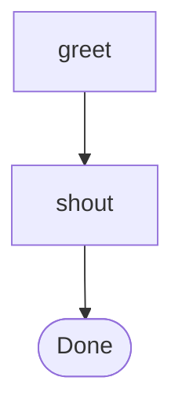

# Getting started

A workflow is two files: a diagram that says what runs in what order, and a tools file that says what each step does.

## 1. Install

```bash
npm install typemaid zod
```

Needs Node 22 or newer, or Bun 1.2 or newer. Zod must be 4.2 or newer.

## 2. Draw the workflow

`flows/hello.mmd` is a plain Mermaid flowchart. Each node name is the name of a step.



## 3. Write the steps

`flows/tools.ts` exports one step per node, under the same name.

```ts
import { z } from 'zod';
import { tool } from 'typemaid';

export const greet = tool({
  input: z.object({ name: z.string() }),
  output: z.object({ greeting: z.string() }),
  run: ({ name }) => ({ greeting: `Hello, ${name}` }),
});

export const shout = tool({
  input: z.object({ greeting: z.string() }),
  output: z.object({ loud: z.string() }),
  run: ({ greeting }) => ({ loud: `${greeting.toUpperCase()}!` }),
});
```

Steps share one bag of data. A step's `input` picks the fields it needs by name; its `output` adds fields for later steps. Here `greet` writes `greeting` and `shout` reads it.

## 4. Run it

```ts
import { run } from 'typemaid';
import * as tools from './flows/tools.ts';

const result = await run('./flows/hello.mmd', tools, { name: 'Ada' });
// { status: 'completed', runId: '...', output: { name: 'Ada', greeting: 'Hello, Ada', loud: 'HELLO, ADA!' } }
```

Or from the command line:

```bash
npx typemaid run flows/hello.mmd --input '{"name":"Ada"}'
```

`run()` never throws for a failing step. It returns one of:

```ts
{ status: 'completed', runId, output }
{ status: 'paused',    runId, waitingAt }   // a human step is waiting for an answer
{ status: 'failed',    runId, error }       // error has code, message and the node
```

## 5. Check it before running

```bash
npx typemaid check flows
```

This finds, without running anything: a node with no matching export, a step that reads a field nothing wrote, a loop without a cap, and syntax the dialect does not accept. `run()` does the same checks first.

## 6. See it

```bash
npm install -D @typemaid/view
```

```bash
npx typemaid view flows
```

## Next

- Branches, loops, parallel steps, for-each, human steps: the [README](../README.md#what-you-can-draw).
- Keeping runs across restarts: [Durability](durability.md).
- Calling a model: [Models](models.md).
