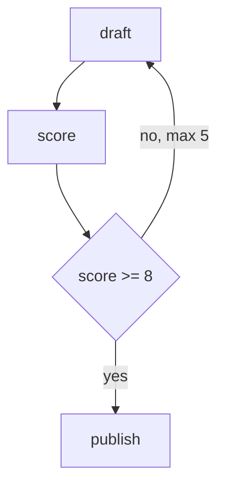

# Retries and time limits

## Retrying a step

Set `retries` on a tool or an agent step. It is the number of extra tries after the first one fails. The default is 0.

```ts
export const fetchPage = tool({
  input: z.object({ url: z.string() }),
  output: z.object({ html: z.string() }),
  retries: 3,
  timeoutMs: 10_000,
  run: async ({ url }, ctx) => {
    const res = await fetch(url, { signal: ctx.signal });
    if (!res.ok) throw new Error(`HTTP ${res.status}`);
    return { html: await res.text() };
  },
});
```

| | |
|---|---|
| Wait between tries | 200 ms, doubling each time, at most 30 s |
| `ctx.attempt` | 1 on the first try, 2 on the next, and so on |
| `ctx.key` | the same on every try; pass it to APIs that take an idempotency key |
| `ctx.signal` | aborted when the try times out or the run is cancelled; pass it to `fetch` |

**Retried:** any error your code throws, and a time-out.

**Not retried:** input that does not match the step's `input` schema, and output that does not match its `output` schema. Trying again would give the same result.

When the tries run out, the run ends with `status: 'failed'` and `error.node` names the step. With a store, `resume(runId, tools, {}, { store })` starts again at that step.

## Time limits

`timeoutMs` on a step limits one try. Without it, the limit is 5 minutes. Change the default for a whole run:

```ts
await run(flow, tools, input, { limits: { timeoutMs: 30_000 } });
```

A time-out aborts `ctx.signal`. Code that ignores the signal keeps running in the background, so pass it on.

## Agent steps

`retries` and `timeoutMs` work the same on agent steps. Separately, when a model's answer does not match the output schema, the model is asked once more inside the same try. If it still does not fit, the step fails without further retries.

## Loops are not retries

A loop in the diagram is part of the workflow, and every loop needs a cap:



When the cap is reached the run fails, rather than looping forever.

## Limits for a whole run

Pass `limits` to `run()` or `resume()`:

| Limit | Default | Meaning |
|---|---|---|
| `maxSteps` | 10,000 | most step executions in one run |
| `timeoutMs` | 300,000 | default limit for one try of one step |
| `concurrency` | 5 | items of a for-each block running at once |
| `maxContextChars` | 5,000,000 | largest shared data, as JSON |

## Watching retries

```ts
await run(flow, tools, input, {
  onEvent: (e) => {
    if (e.type === 'node.retry') console.warn(`${e.node} failed (try ${e.attempt}): ${e.error}`);
  },
});
```

## Cancelling

Pass an `AbortSignal` as `signal`. Waiting between retries stops at once, and running steps see `ctx.signal` abort.
