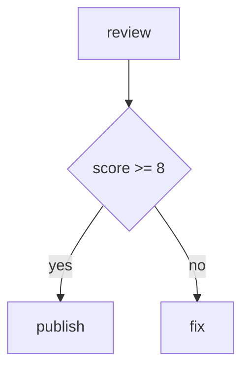
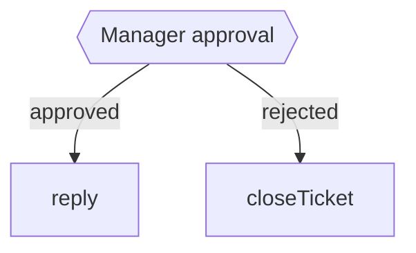

Everything about what runs next is in the diagram. This page covers decisions, loops, parallel branches, for-each blocks and entry points.

## Decisions

A diamond is a decision. It needs two arrows out, labelled `yes` and `no`.



A condition can:

- compare fields with numbers (`10`, `-2.5`), text and `true`/`false`/`null` using `== != > >= < <=`;
- combine with `and`, `or`, `not` and brackets;
- read nested fields (`user.age`) and `.length` (`bullets.length >= 3`).

Text goes in single quotes: `{"status == 'ok'"}`. A bare field name such as `{isSpam}` tests that field.

For anything more involved, name an exported function that takes the shared fields and returns a boolean:

```ts
// diagram: ok{isBusinessHours}
export const isBusinessHours = (ctx: { now: string }) => new Date(ctx.now).getUTCHours() < 17;
```

## Choices made by a step

A step can pick between arrows labelled `approved` and `rejected`. The step's `decision` output chooses which one is followed. This is how a [human step](/docs/guides/pausing/) routes the run:



## Loops

An arrow back to an earlier node makes a loop. Every loop needs a cap, written as `max` on the arrow:

```mermaid file=examples/review-loop/review-loop.mmd
```

`no, max 5` means: follow this arrow when the condition is false, at most 5 times. A loop without `max` is an error, so a run cannot loop forever.

## Parallel branches

Two unlabelled arrows out of one node run both branches at the same time. They join where they meet, and the next step runs once both are done.

```mermaid
flowchart TD
  start --> fetchProfile
  start --> fetchOrders
  fetchProfile --> report
  fetchOrders --> report
```

## For-each

A subgraph with the `foreach` class runs its steps once per item of a list. Its title says which list and what each item is called.

```mermaid file=examples/emails/emails.mmd
```

- Items run a few at a time (5 by default, set with `limits.concurrency` in `run()`).
- Inside the block, each step sees the current item as `email`.
- After the block, the results are in a list named after the block (`each`), in input order.
- The block is saved as a whole: a crash in the middle re-runs the whole block. Human steps are not allowed inside one yet.

See the [email inbox example](/docs/examples/email-inbox/).

## Several entry points

Mark nodes with `:::start` to give a flow more than one way in. The first one is the default; choose another with `start`:

```mermaid file=examples/sync/sync.mmd
```

```ts
await run('./sync.mmd', tools);                                         // starts at fetch
await run('./sync.mmd', tools, { items: [10, 20] }, { start: 'webhook' }); // starts at webhook
```

Each entry point is checked for its own required inputs. See the [paged sync example](/docs/examples/sync/).
