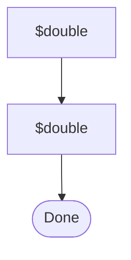

A workflow is a Mermaid flowchart in a `.mmd` (or `.mermaid`) file. It is plain Mermaid, so it previews on GitHub and in any Mermaid viewer.

```mermaid file=examples/hello/hello.mmd
```

## Node names are exports

Each box's name is the export that runs for it. In the diagram above, `greet` and `shout` run the exports with those names from your tools file.

```ts file=examples/hello/tools.ts
```

The text in brackets is only a label for people. `draft[Write a draft]` runs the export `draft` and shows "Write a draft".

To use one tool at two places in a diagram, give each box its own name and point it at the export with `$`:



## Shapes

| In the diagram | Meaning |
|---|---|
| `name[Label]` | A step. Runs the export `name`. |
| `name[$other]` | A step that runs the export `other`. |
| `ok{"score >= 8"}` or `ok{passes}` | A decision. Needs two arrows labelled `yes` and `no`. See [Control flow](/docs/concepts/control-flow/). |
| `([Done])` | A start or end marker. Runs nothing. |
| `:::agent`, `:::human` | Optional hints, checked against what the export really is. |
| `:::start` | Marks an entry point. See [several entry points](/docs/concepts/control-flow/#several-entry-points). |

## Where a run starts

- With no `:::start` anywhere, the flow starts at the one node with no arrow into it.
- If every node is inside a loop, it starts at the node written first.
- With `:::start` on several nodes, each is a named entry point: `run(flow, tools, input, { start: 'webhook' })`.

## What is not allowed

Anything else Mermaid allows (other arrow styles, `&`, click actions, directives, other shapes) is rejected with a message. It is never silently ignored, so a diagram cannot mean something other than what it shows.

Styling lines (`classDef`, `style`, `linkStyle`, `direction`, frontmatter) are allowed and have no effect on the run.

## Passing a diagram

`run()` accepts a diagram in three forms:

- **A file path or URL:** `run('./flows/hello.mmd', …)` or `run(new URL('./hello.mmd', import.meta.url), …)`. A string is read as a file when it ends in `.mmd` or `.mermaid`, or starts with `file:`.
- **Mermaid text:** any other string is treated as the diagram itself. Use this in browsers and edge runtimes.
- **A compiled flow** from [`compile()`](/docs/api/compile/). Use this when the text comes from someone you do not trust, so you control compilation.
