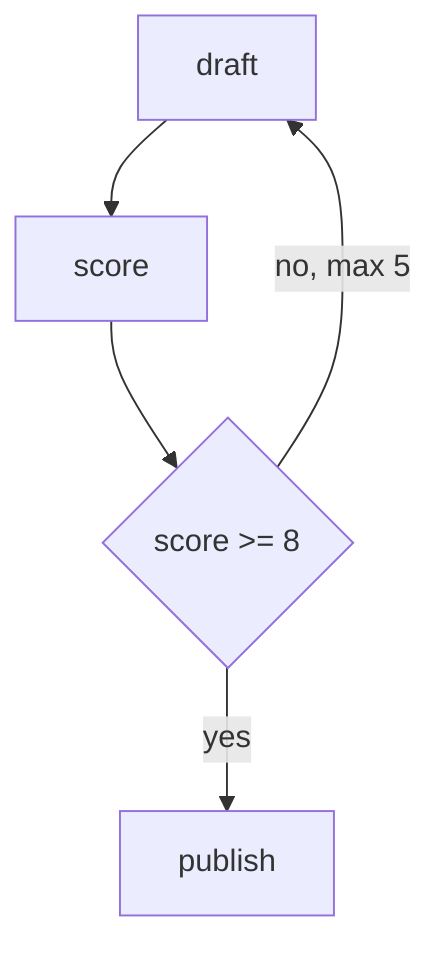

typemaid is built from a few well-known ideas: a workflow is a graph, the graph is checked like a program, data is typed, runs are saved after each move, and two workers can never both continue one run. This page explains each idea, what typemaid guarantees because of it, and where the limits are.

## The diagram is compiled

A `.mmd` file is source code. typemaid parses it, checks it, and compiles it to plain JSON: the nodes, the arrows, and what each node does. That JSON is what runs, and what is saved with each run.

- The compiler is pure: no file system, network, `eval` or imports at run time. The same text always compiles to the same JSON.
- Every compiled flow carries a hash of the diagram text. Stores save it with each run, so you can see which version of a diagram a run started from.
- A problem is reported, not guessed around. A diagram never runs differently from how it looks.

See [`compile()` and `check()`](/docs/api/compile/).

## A graph with capped loops

A workflow is a directed graph: steps are nodes, arrows are edges. Remove the loop arrows and what is left must be a DAG, a directed graph with no cycles. Every arrow that goes back needs a cap:

Before anything runs, typemaid checks that:

- every loop has a `max` (`E1106`);
- every node can be reached from a start (`E1103`);
- every node has a path to an end, so no part of the flow is a trap (`E1110`).

With every loop capped, every run ends: it completes, pauses for a person, or fails at a cap. On top of that, `maxSteps` limits the total number of steps in a run.

## Types from end to end

Each step declares its input and output with a schema. typemaid reads schemas through [Standard Schema](https://standardschema.dev), and these docs use Zod.

Before a run starts, typemaid follows the data through the graph:

- every field a step reads must be produced by an earlier step or passed to `run()` (`E1301`);
- two steps that output the same field must agree on its type (`E1204`);
- a step that reads a field must expect the type that is produced (`E1205`).

While the run goes, each step's input and output are checked against its schemas (`E1320`, `E1322`). An agent's answer is checked too, and the model is asked once more if it does not fit.

See [Data flow](/docs/concepts/data-flow/).

## The diagram decides what runs next

Routing is deterministic. The next step is chosen by the arrows you drew, never by a model.

- A decision node uses a small condition language. It can read fields and compare them; it cannot call functions, read the time, or use randomness.
- A step with labelled arrows (for example a model choosing `refund` or `reply`) can only pick one of those labels. Any other answer fails the run (`E1311`).

So the same data always takes the same path, and every possible path is visible in the diagram.

## Parallel branches that cannot race

When a node has several unlabelled arrows out, the branches run at the same time. Where they meet again is the join: typemaid finds it as the first node that every branch must pass through (its post-dominator), and waits there for all of them. If the branches never meet, each runs to its own end.

Parallel code often has races. typemaid rules out the ones it can see:

- branches must stay separate until they meet (`E1107`);
- two parallel steps may not output the same field (`E1210`), so the result never depends on which finished last.

A for-each block runs its steps once per item in a list, with at most `concurrency` items (5 by default) at once.

See [Control flow](/docs/concepts/control-flow/).

## Durable execution

With a [store](/docs/stores/), a run is durable: its state is saved as it moves, and it can continue in another process after a crash, a deploy, or a pause of several days.

The saved state is small and plain JSON:

- the shared fields;
- where the run is in the graph (one marker per active branch);
- loop counters and how many times each step has run;
- the compiled diagram the run started with, so editing the file never changes a run in progress.

`resume()` loads that state and continues from the last saved point. A human step is the same mechanism: the run saves itself and stops, and `resume()` continues it with the person's answer.

See [Durability](/docs/durability/).

## At least once, with idempotency keys

A step runs, then its result is saved. If the process dies between the two, the step runs again on resume. This is called at-least-once execution: a step's result is recorded once, but its code may run more than once.

For work that must not repeat, such as charging a card, each step gets `ctx.key`. It is built from the run, the step and how many times that step has run, so it is the same on every retry and every re-run. Pass it to any API that accepts an idempotency key.

## One writer per run

Each saved run has a version number. A save says which version it expects to replace, and the store refuses it if the run has moved on. This is optimistic concurrency control: no locks, but no lost updates.

If two workers resume the same run, the first save wins. The other gets `StaleRunError` and stops, so the run is never continued twice. Every store must pass the same contract tests, which check this.

## Bounded by default

A run cannot grow without limit:

| Limit | Default | What it stops |
|---|---|---|
| Loop caps | Required on every loop | Endless loops |
| `maxSteps` | 10,000 | Runaway runs |
| `timeoutMs` | 5 minutes per try | A step that hangs |
| `concurrency` | 5 | Too many for-each items at once |
| `maxContextChars` | 5,000,000 | Shared data that grows too large |

See [Retries and time limits](/docs/retries/).

## What typemaid does not do

- **No background worker.** Nothing resumes a run on its own; your code calls `resume()`.
- **No exactly-once.** Steps are at least once; use `ctx.key` for side effects.
- **No partial for-each saves.** A for-each block is saved as a whole, so a crash inside it re-runs the block.
- **No hosted service.** typemaid is a library. Runs live in your process and your database.
