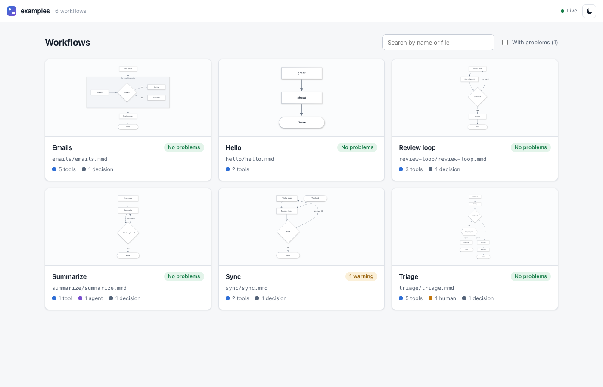
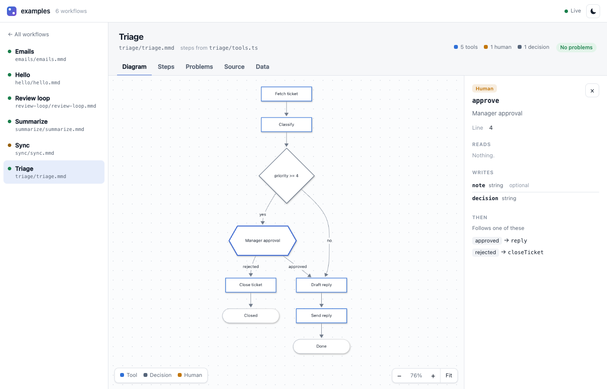

The viewer draws your workflows in the browser, lists every step with its fields, and shows problems as you save. It is a separate package, so projects that only run workflows stay small.

```bash
npm install -D @typemaid/view
npx typemaid view flows
```

Give it one file to open that diagram, or a folder to list every workflow in it. The page updates when you save a file.





## What it shows

- **Diagram:** your Mermaid drawn by Mermaid itself, with pan and zoom. Click a step to see what it reads, what it writes and where it goes next.
- **Steps:** every step in a table, with its kind and fields.
- **Problems:** the same checks as `typemaid check`, linked to the line.
- **Source** and **Data:** the file with problem lines marked, and the raw data behind the page.
- Light and dark themes; works offline.

## From code

```ts
import { view } from '@typemaid/view';

const viewer = await view('./flows', { open: true });
console.log(viewer.url);
// later
await viewer.close();
```

Options are in the [CLI and view() reference](/docs/api/cli/).

## Safety

- **This computer only, read-only.** The page is served on `127.0.0.1`, accepts only read requests, refuses other websites and unexpected host names, and loads nothing from the internet.
- **Step details come from your tools file,** so that file's code is loaded. Pass `--no-tools` (or `tools: false`) to draw diagrams without loading any code.
- **No run history yet.** The viewer shows what a workflow is, not what its runs did.
